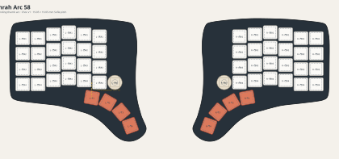

# Hamrah Arc 58

A low-profile, split 58-input keyboard built around Kailh Choc v1 hotswap
switches, KEEBD Helios RP2040 controllers, per-key RGB, OLEDs, clickable
encoders, and a fully reversible PCB. The design keeps the approved Sofle Choc
6x4 column-staggered field and replaces the original bottom cluster with a
four-key inward/downward Arc thumb fan.

Each half has 29 press inputs:

- 24 column-staggered main keys;
- four Arc thumb keys; and
- one clickable rotary encoder.

## Layout preview

[](output/keyboard-layout.svg)

[Open the full-size SVG](output/keyboard-layout.svg)

## Geometry

All dimensions live in `layout.config.json`.

| Parameter | Value |
| --- | ---: |
| Main matrix pitch | 19.05 x 19.05 mm |
| Choc plate cutout | 14 x 14 mm |
| Choc keys per half | 28 |
| Clickable encoders per half | 1 |
| Thumb center spacing | 20.5 mm |
| Thumb key rotations | 10, 30, 50, 70 degrees |
| Mounting holes per half | 6 x 2.2 mm |

## Generate and verify

Node.js 18 or newer and KiCad 9 are required.

```sh
npm run generate
npm run verify
npm run generate:enclosures
```

Generation creates the mirrored layout, a US Letter 1:1 paper test, exact key
positions, and left/right top and bottom plate SVG/DXF files under `output/`.
Print the paper test at Actual Size / 100% and confirm its calibration bar is
exactly 50 mm before ordering plates.

`generate:enclosures` additionally creates vendor ZIP packages for 1.5 mm
acrylic top plates, 3 mm acrylic bottom plates, and a 6061-T6 machined aluminum
case under `output/manufacturing/`. It uses `uv` with Python 3.12 to run the
CadQuery solid-model generator. Material, tolerances, fit-coupon instructions,
and the nominal hardware stack are documented in
[`hardware/ENCLOSURES.md`](hardware/ENCLOSURES.md).

The single native PCB project is:

```text
hardware/kicad/arc58-reversible.kicad_pro
hardware/kicad/arc58-reversible.kicad_pcb
```

Order two copies of the same Rev Beta PCB. In the assembled keyboard, the B.Cu
face points toward the keycaps on the left half and the F.Cu face points toward
the keycaps on the right half. Detailed component-side selection, verified pin
mapping, DRC status, and safety notes are in `hardware/README.md`; the pair BOM is
`hardware/BOM-REV-BETA.csv`.

Rev Beta replaces the original Rev Alpha fabrication files. Do not build or
reorder Rev Alpha: it has no routed optical/package apertures for per-key RGB,
its TRRS jack points toward the encoder instead of the cable exit, and its
four thumb-switch axes are mirrored to the wrong physical angles. Rev Alpha
may be electrically bench-tested with every RGB LED omitted and without an
enclosure, but it does not implement the intended keyboard. Do not hand-cut a
populated PCB; use Rev Beta for the corrected thumb fan, per-key RGB, and
unobstructed TRRS cable access.

## Prototype status

The routed board passes the repository's structural and electrical checks:
zero unrouted connections and zero shorts, crossings, or fabrication-clearance
violations. Its Edge.Cuts layer contains 28 closed 3.6 x 3.1 mm RGB apertures
per half, and the inner-edge TRRS jack/plate geometry provides a 10 mm cable
opening. The switch locator holes independently verify the assembled thumb
axes: +10, +30, +50, and +70 degrees on the B.Cu/left half, mirrored to -10,
-30, -50, and -70 degrees on the F.Cu/right half. QMK is configured for
Helios, a one-wire TRRS split, OLED, encoder, and a 28+28 RGB Matrix. The
default firmware also compiles successfully against current upstream QMK; the
ignored local UF2 is generated at
`output/firmware/arc58-rev-beta-default.uf2`.

This is still a prototype until a fabricated pair passes
`hardware/BRING-UP-CHECKLIST.md`. Choc switches plug into soldered hotswap
sockets; the switches themselves are not soldered to the PCB. Use a small
prototype order and verify switch/plate fit, diode and LED orientation, USB
current, every key, both encoders, both OLEDs, RGB, and the split link before a
larger run.
